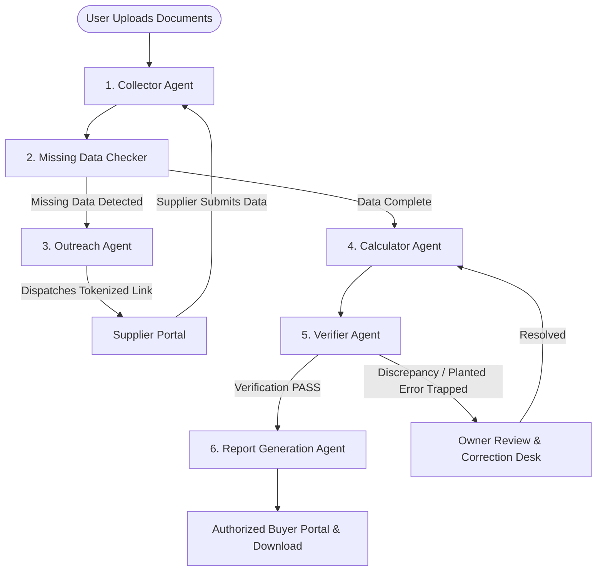

# CarbonGuard AI — Multi-Agent Carbon Compliance Platform

**Problem Statement:** SUS-01 – Carbon Compliance Agents for Indian Exporters  
**Category:** Sustainability & Environmental Technology  
**Target Users:** Indian MSME exporters, manufacturers, suppliers, and authorized European Union buyers.

---

## 1. Executive Summary

**CarbonGuard AI** is a production-ready, full-stack, AI-powered multi-agent carbon compliance management platform. It empowers Indian MSME exporters to automate product embedded-emissions data collection, supplier communication, deterministic carbon accounting, independent verification, and audit-ready report generation under the European Union’s Carbon Border Adjustment Mechanism (**EU CBAM**).

Many Indian exporters do not have organized emissions data. Their information is scattered across Discom electricity bills, fuel receipts, furnace logs, mill test certificates, and spreadsheets. CarbonGuard AI solves this with a team of six autonomous agents orchestrated via LangGraph communicating over a shared compliance state.

---

## 2. Technology Stack

### Frontend & Next.js API Layer
- **Next.js 16 (App Router)** & TypeScript
- **Tailwind CSS** with clean, modern emerald-themed UI
- **Lucide React** for icons
- **Recharts** for interactive emissions & compliance data visualizations
- **React Hook Form & Zod** for input validation
- **Supabase JS & SSR** for Auth, PostgreSQL, and Storage

### Backend & Multi-Agent Engine
- **Python 3.12 + FastAPI + Uvicorn** for high-throughput document processing
- **LangGraph** for multi-agent stategraph orchestration and conditional routing
- **PyMuPDF (fitz)** for PDF document parsing and text extraction
- **Pandas & OpenPyXL** for production log and spreadsheet processing
- **ReportLab** for audit-ready, stamped PDF compliance report generation
- **Official CEA India Grid Baseline (v19/20)** and **IPCC 2006 Fuel Factors** for deterministic arithmetic

---

## 3. Six Multi-Agent System Architecture



1. **Collector Agent**: Extracts activity values, metric units, document citations, page numbers, and confidence scores from digital invoices, electricity bills, and test certificates.
2. **Missing Data Checker**: Compares extracted data against mandatory CBAM requirements for specific product categories (Iron & Steel, Aluminium, Cement, Fertilizers, Hydrogen).
3. **Outreach Agent**: Generates polite, personalized emails with unique, time-limited tokenized links allowing suppliers to submit data securely without access to internal company files.
4. **Calculator Agent**: Implements 100% deterministic arithmetic ($E_{direct} + E_{indirect} + E_{precursor}$) and calculates specific emissions intensity ($tCO_2e/t$). No LLM numerical hallucinations.
5. **Verifier Agent**: Independently challenges figures, audits arithmetic, and cross-checks documents (e.g. catches planted discrepancies between Commercial Invoices and Test Certificates).
6. **Report Generation Agent**: Produces tamper-evident, audit-ready PDF certificates via ReportLab complete with emission factor citations, traceability tables, and verification stamps.

---

## 4. Complete User Journey & Key Pages

| Route | Page | Purpose |
|---|---|---|
| `/` | **Public Landing Page** | Explains the CBAM problem, showcases the 4 AI agent roles, Indian MSME benefits, and workflow. |
| `/register` | **User Registration** | Supabase Auth registration collecting company name, type, address, GSTIN, IEC, and contact. |
| `/login` | **User Login** | Secure sign-in with 1-click instant demo mode. |
| `/dashboard` | **Owner Overview** | Recharts visualizations (emissions by source, product intensity, trends), KPI cards, and live activity feed. |
| `/dashboard/cases/new` | **New Case Creation** | Full wizard collecting product classification, supplier contact, and authorized buyer. |
| `/dashboard/cases/[id]/documents` | **Document Dropzone** | Multi-file upload, category selector, supplier outreach authorization toggle, and AI analysis trigger. |
| `/dashboard/cases/[id]` | **Case Inspection & Agent Live State** | Live agent visualizer, extracted data citations, deterministic formulas, **Planted Error Sandbox**, and PDF download. |
| `/supplier/upload?token=...` | **Supplier Response Portal** | Public, tokenized portal for suppliers to submit missing records or report data unavailable. |
| `/report/verify?caseId=...` | **Authorized Buyer Portal** | Clean certificate gateway for European Union importers to verify specific carbon intensity. |

---

## 5. Quickstart Guide

### Prerequisites
- Node.js 18+ (tested with Node.js v24)
- Python 3.12+

### Running the Application

1. **Start the Next.js Frontend:**
   ```bash
   npm run dev
   # Opens on http://localhost:3000
   ```

2. **Start the Python Multi-Agent FastAPI Backend (Optional / Parallel):**
   ```bash
   npm run backend:dev
   # Opens on http://127.0.0.1:8000
   ```

3. **Or run both with a single click:**
   Double-click `run_dev.bat` or execute `.\run_dev.bat` in PowerShell.

---

## 6. How to Test the Planted Error Trap & Verification

To demonstrate the Verifier Agent catching planted errors as specified in the master prompt:
1. Open any case (e.g. `http://localhost:3000/dashboard/cases/case-001`).
2. Click the **"Test Planted Error Trap"** button at the top right.
3. The system modifies the extracted commercial invoice quantity to `46.66 MT` while the physical mill test certificate remains `48.66 MT`.
4. The **Verifier Agent immediately flags the discrepancy**, marks the consignment as `FLAGGED / REVIEW_REQUIRED`, explains the exact 2.00 MT variance, and halts official certificate issuance.
5. Click **"Resolve Discrepancy"** to reconcile the records back to `48.66 MT` — the Verifier updates status to `PASS` and unlocks the audit-ready report!

---

## 7. Running the Automated Test Suite

To run the automated Python multi-agent pipeline tests:
```bash
npm run test:agents
```
This runs the full 6-agent LangGraph workflow, supplier response simulation, deterministic calculation verification, planted error trap check, and ReportLab PDF compilation.

